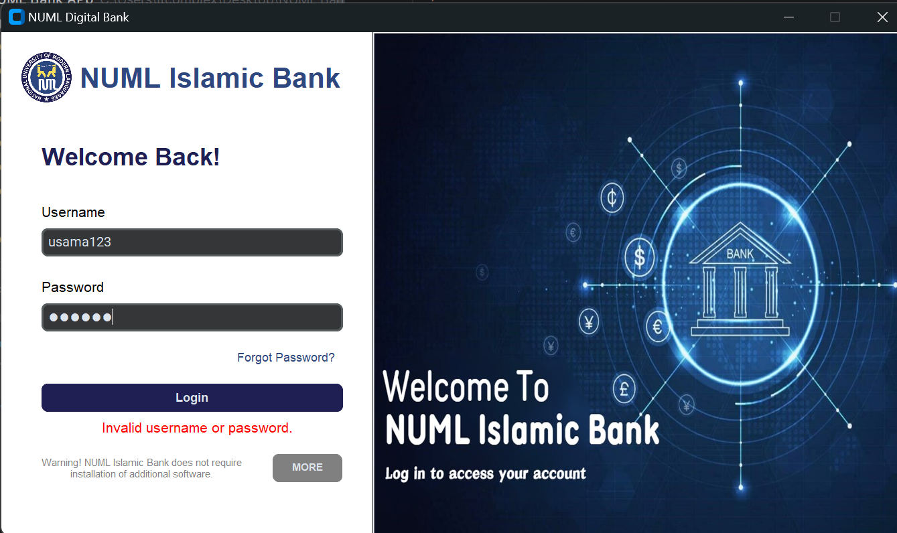
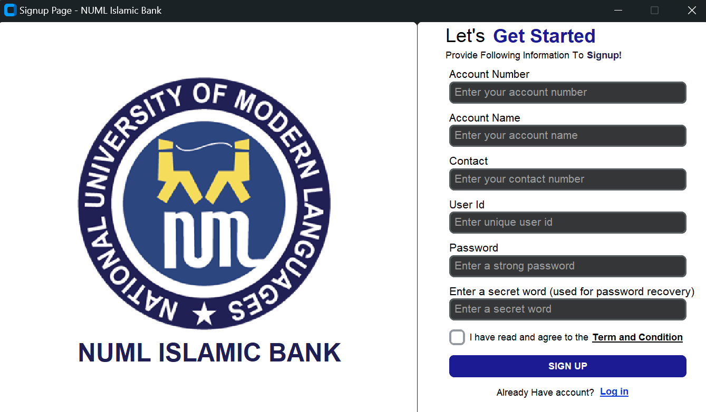
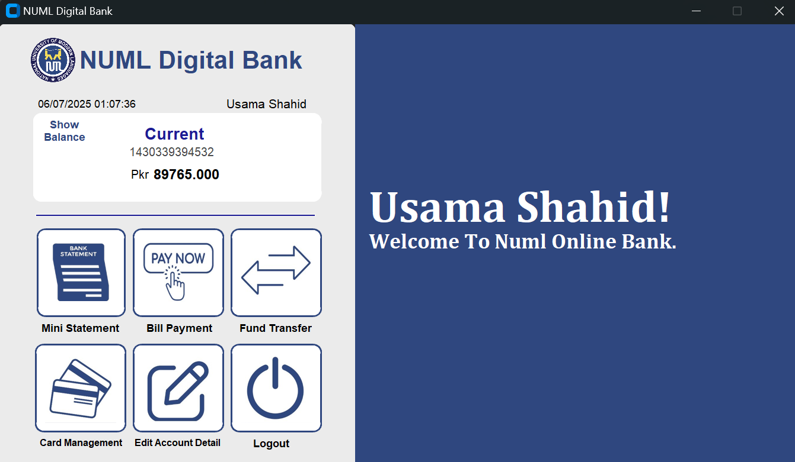
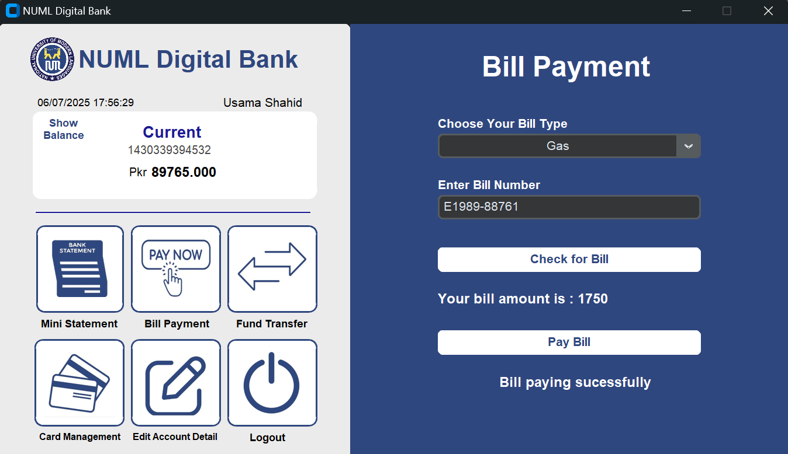
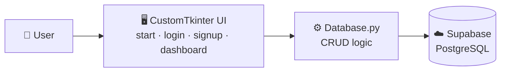

<!-- BankApp · README by Usama Shahid (fewgets) -->
<div align="center">


<p>
  
  
  
  
</p>

</div>

---
## 📌 Overview

**BankApp** is a desktop banking application built with **Python** and **CustomTkinter**, with
**Supabase (PostgreSQL)** as the cloud backend. Users can open an account, log in, check their
balance, transfer money, pay bills, manage their card PIN and view their transaction history,
all from a clean, modern desktop interface.

---

## 📷 Screenshots

| Login | Sign Up |
|:-:|:-:|
|  |  |
| **Dashboard** | **Transaction History** |
|  |  |

---

## ✨ Features

| | Feature | Description |
|:-:|---|---|
| 🔐 | **Sign Up & Login** | Account creation and secure login |
| 🔑 | **Forgot Password** | Recover access to an account |
| 💰 | **Balance Management** | Live balance stored in the cloud |
| 💸 | **Transfers & Bill Payments** | Move money and pay bills from the dashboard |
| 💳 | **Card PIN Management** | Change your card PIN at any time |
| 📜 | **Mini Statement** | Full transaction history |
| ☁️ | **Supabase Backend** | All data stored in PostgreSQL via the Supabase API |

---

## 🏗️ Architecture



| File | Responsibility |
|---|---|
| `main.py` / `start.py` | App entry and the start screen (login or sign up) |
| `login_page.py` · `signup_page.py` · `forgot_password.py` | Authentication screens |
| `first_page.py` | Account dashboard |
| `Database.py` | All Supabase operations |
| `config.py` | Supabase URL and key (you fill these in) |
| `sql_queries.txt` | Database schema |

---

## 🚀 Run Locally

### 1. Clone and install

```bash
git clone https://github.com/fewgets/BankApp.git
cd BankApp
pip install customtkinter supabase pillow
```

### 2. Set up Supabase

1. Create a free project at [supabase.com](https://supabase.com).
2. Open **SQL Editor**, paste the contents of `sql_queries.txt` and run it. This creates the `users`, `transaction` and `card_management` tables.
3. Add your project credentials to `config.py`:

```python
url = "https://your-project.supabase.co"
key = "your-supabase-anon-key"
```

### 3. Start the app

```bash
python main.py
```

---

## 🛡️ Notes

- New accounts start with a demo balance of **10,000** and a default PIN of **0000**. Change it after the first login.
- Never commit real Supabase keys. Keep `config.py` local.

---

## 🧰 Tech Stack

| Component | Tool |
|---|---|
| Language | Python 3 |
| UI | CustomTkinter, Pillow |
| Backend | Supabase (PostgreSQL) via `supabase-py` |

---

## 🤝 Let's Work Together

<div align="center">

**Have an idea, a freelance project, or want to collaborate on something in AI?**
I'm always open to collaborations, freelance work and full-time opportunities.

<a href="mailto:shaikhusama541@gmail.com?subject=Collaboration%20-%20BankApp">
  
</a>
<a href="https://www.linkedin.com/in/-usamashahid/">
  
</a>
<a href="https://github.com/fewgets">
  
</a>

<br/><br/>

⭐ **If you like this project, please give it a star. It really helps!** ⭐

<br/>

<h3>"Good software makes handling money feel simple."</h3>


</div>
